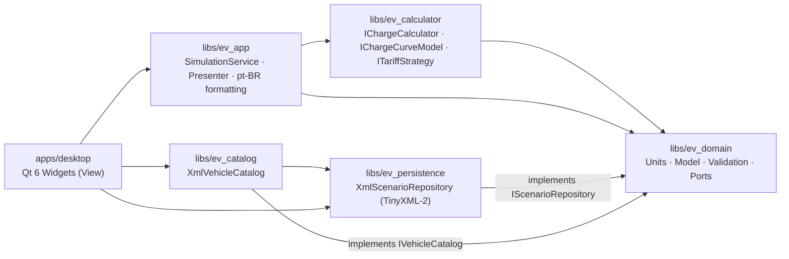

# EV Charge Simulator · Simulador de Recarga de Veículo Elétrico

[](../../actions/workflows/ci.yml)


> 🇬🇧 [English](#english) · 🇧🇷 [Português](#português)
>
> Implements specification **ERS-VE-001 v1.0**: requirements, architecture, tests and validation.

---

## English

### Overview

A desktop simulator that estimates, for an electric-vehicle charging session:

- **energy** stored in the battery and drawn from the grid,
- **duration** (decimal hours and h/min),
- **cost** (energy + fixed fee + per-minute rate),
- **range** added and final estimated range.

All assumptions are shown next to the results. Calculations are deterministic and reproducible.

> ⚠️ **Results are estimates.** They can vary with temperature, battery ageing, power sharing, the
> vehicle's charge curve and losses. This is not a certified meter and must not be used for billing.

### Features (MVP scope: MUST + SHOULD)

| ID | Feature | Status |
|----|---------|--------|
| RF-001..007 | Input, validation, energy, time, cost, range, assumptions | ✅ |
| RF-008 | Side-by-side comparison of 3+ scenarios (cheapest/fastest highlighted) | ✅ |
| RF-009 | Save/open scenarios as versioned XML (schema 1.0) | ✅ |
| RF-010 | Copy structured summary to clipboard (MVP) | ✅ |
| RF-012 | Segmented charge curve by SoC band | ✅ |
| RF-013 | Local vehicle catalog (⚠️ approximate, **unverified** data) | ✅ |
| RF-011, RF-014 | Unit conversion, local history | ⏳ not implemented (COULD) |

### Architecture



- The UI contains **no formulas**. It converts widget values into `ChargeRequest`, calls `SimulationService`
  and binds the pre-formatted `ResultView` strings.
- Persistence and the catalog implement ports defined in the domain (dependency inversion).
- The engine has no dependency on the GUI or the filesystem.

### Repository layout

```
.
├── apps/desktop/            Qt 6 Widgets application (MainWindow, main)
├── libs/
│   ├── ev_domain/           strong units, model, validation, error codes, ports
│   ├── ev_calculator/       base engine, constant/segmented curve, composite tariff
│   ├── ev_persistence/      XML scenarios, limits, atomic save
│   ├── ev_catalog/          XML vehicle catalog + data/vehicles.xml
│   └── ev_app/              application service, presenter, pt-BR formatting
├── tests/
│   ├── unit/                UT-001..015 (GoogleTest, parameterized)
│   ├── component/           service + presenter + p95 performance (GoogleMock at boundaries)
│   ├── integration/         IT-001..009 + catalog, with XML fixtures
│   └── common/              shared test data
├── cmake/                   FetchContent dependencies
├── docs/adr/                architecture decision records
└── .github/                 CI workflow, issue and PR templates
```

### Prerequisites

| Tool | Version |
|------|---------|
| CMake | ≥ 3.25 |
| C++ compiler | MSVC 2022+, GCC ≥ 11 or Clang ≥ 14 (C++17 with floating-point `<charconv>`) |
| Qt | 6.2+ *(desktop app only)* |
| Network | first configure downloads TinyXML-2 and GoogleTest |

### Build and test

```bash
# Core libraries + tests (no Qt needed)
cmake --preset core
cmake --build --preset core
ctest --preset core

# Everything, including the desktop app (Qt 6 must be discoverable)
cmake --preset dev -DCMAKE_PREFIX_PATH=/path/to/Qt/6.x/<compiler>
cmake --build --preset dev
ctest --preset dev
```

On Windows without the Visual Studio generator CMake expects, open a *Developer PowerShell* and add
`-G "NMake Makefiles"` or `-G Ninja` to the configure command.

### Run the desktop app

```bash
./build/dev/apps/desktop/ev_desktop        # Linux
build\dev\apps\desktop\Debug\ev_desktop.exe  # Windows (multi-config generator)
```

On Windows, run `windeployqt` on the executable, or add Qt's `bin` folder to `PATH`.

### Windows portable package

Build in Release, then copy the executable, the catalog, the Qt DLLs and the MSVC runtime into one folder.
Run this from a *Developer PowerShell for VS* (the folder name below is only an example):

```powershell
cmake --preset release -G "NMake Makefiles" -DCMAKE_PREFIX_PATH=C:\path\to\Qt\6.8.3\msvc2022_64
cmake --build --preset release
$dist = "EVChargeSimulator_v0.1.0_win64"
New-Item -ItemType Directory -Force "$dist\data" | Out-Null
Copy-Item build\release\apps\desktop\ev_desktop.exe "$dist\EVChargeSimulator.exe"
Copy-Item libs\ev_catalog\data\vehicles.xml "$dist\data\"
C:\path\to\Qt\6.8.3\msvc2022_64\bin\windeployqt.exe --release --no-translations --no-system-d3d-compiler `
    --no-system-dxc-compiler --no-opengl-sw --no-compiler-runtime "$dist\EVChargeSimulator.exe"
Copy-Item "$env:VCToolsRedistDir\x64\Microsoft.VC*.CRT\*.dll" $dist   # app-local MSVC runtime
Compress-Archive $dist "$dist.zip"
```

The resulting folder (about 27 MB) runs on a PC without Qt or Visual Studio. Keep `data\vehicles.xml` next to the
`.exe`. Distributing Qt DLLs requires complying with the Qt license (LGPLv3); see [ADR-0001](docs/adr/0001-ui-qt6-widgets.md).

**Main flow (spec §7.1):** choose a catalog vehicle or type values in manually → charger → SoC, efficiency and tariff
→ **Enter** to calculate → review the cards, details and warnings → *Adicionar à comparação* → **Ctrl+S** to
save the XML, **Ctrl+O** to open one, or **Ctrl+Shift+C** to copy the summary.

### Calculation model (spec §2.1)

```
E_bat     = C_util × (SoC_target − SoC_current) / 100
E_grid    = E_bat / η                                 (η ∈ [0.5, 1.0])
P_eff     = min(P_charger, P_vehicle, P_installation)
t_h       = E_grid / P_eff                            (sum over SoC bands when a curve is used)
Cost      = E_grid × rate_kWh + fixed_fee + t_min × rate_min
km_added  = E_bat / (consumption_kWh_100km / 100)
km_final  = km_current + km_added, capped at the range at 100% and the rated range (RN-08)
```

Reference example (§2.3, verified by `UT-001` and the component test for UAT-08): 60 kWh, 20%→80%, 11 kW charger,
7.4 kW vehicle, 90%, R$ 0,95/kWh, 16 kWh/100 km → **40,00 kWh · 5 h 24 min · R$ 38,00 · 225 km**.

### Error and warning codes

| Code | Meaning |
|------|---------|
| VAL-001 | SoC outside 0..100 |
| VAL-002 | Target SoC ≤ current SoC (both fields highlighted) |
| VAL-003 | Power ≤ 0 (charger, vehicle, installation or curve band) |
| VAL-004 | Efficiency outside 50%..100% |
| VAL-005 | Consumption ≤ 0 |
| VAL-006 | Usable capacity ≤ 0 |
| VAL-007 | Negative tariff value |
| VAL-008 | Rated range ≤ 0 |
| VAL-009 | Invalid curve bands |
| IO-001 | Invalid XML / version / structure (includes field path) |
| IO-002 | Save failed; previous file preserved |
| CALC-001 | Non-finite result |
| WARN-001..004 | Constant power model · range capped · unknown XML element · decimal comma normalized |

See [ADR-0007](docs/adr/0007-error-codes.md).

### Test traceability

| Spec | Test location |
|------|---------------|
| UT-001..014 | [tests/unit/CalculatorTest.cpp](tests/unit/CalculatorTest.cpp), [ValidationTest.cpp](tests/unit/ValidationTest.cpp), [TariffAndCurveTest.cpp](tests/unit/TariffAndCurveTest.cpp) |
| UT-015, RN-06 | [tests/unit/FormattingTest.cpp](tests/unit/FormattingTest.cpp) |
| RNF-003 (oracle, 0.1%) | `ChargeCalculatorOracle` parameterized suite |
| RNF-001 (p95 < 200 ms) | `Performance.Simulate_TypicalScenario_P95Below200ms` |
| RNF-002, UAT-03/05/07/08 | [tests/component/SimulationServiceTest.cpp](tests/component/SimulationServiceTest.cpp) |
| IT-001..009 | [tests/integration/XmlScenarioRepositoryTest.cpp](tests/integration/XmlScenarioRepositoryTest.cpp) |
| RF-013 | [tests/integration/VehicleCatalogTest.cpp](tests/integration/VehicleCatalogTest.cpp) |

### Not yet implemented / open items

- IT-010 fuzzing (libFuzzer), sanitizer, clang-tidy/cppcheck, CodeQL and packaging jobs (spec §10.3).
- UI tests (Qt Test) and E2E (`tests/e2e`); the Windows CI job builds core only (no Qt).
- An oracle spreadsheet with 20+ scenarios (spec §9.2).
- Catalog data must be verified by Product ([ADR-0008](docs/adr/0008-vehicle-catalog-data.md)).
- VAL-009, IO-002 and WARN-* codes still need Product approval.

### Contributing

Short-lived branches from `main`, a pull request is required, squash merge, and tags use `vMAJOR.MINOR.PATCH`. Use
the issue templates (requirement / defect / tech debt) and the PR checklist. Changes to the calculation, the XML
schema or security need two approvals (spec §10.2).

### License

Proprietary; a license has not been chosen yet. See [LICENSE](LICENSE). Security: [SECURITY.md](SECURITY.md).
Changes: [CHANGELOG.md](CHANGELOG.md).

---

## Português

### Visão geral

Simulador desktop que estima, para uma sessão de recarga de veículo elétrico:

- **energia** armazenada na bateria e consumida da rede;
- **duração** (horas decimais e h/min);
- **custo** (energia + taxa fixa + tarifa por minuto);
- **autonomia** adicionada e autonomia final estimada.

As premissas são exibidas junto aos resultados, e os cálculos são determinísticos e reproduzíveis.

> ⚠️ **O resultado é estimado.** Pode variar com temperatura, envelhecimento da bateria, compartilhamento
> de potência, curva de carga do veículo e perdas. Não é medidor certificado nem base fiscal.

### Funcionalidades (escopo MVP: MUST + SHOULD)

| ID | Funcionalidade | Status |
|----|----------------|--------|
| RF-001..007 | Entrada, validação, energia, tempo, custo, autonomia, premissas | ✅ |
| RF-008 | Comparação lado a lado de 3+ cenários (menor custo/tempo destacados) | ✅ |
| RF-009 | Salvar/abrir cenários em XML versionado (schema 1.0) | ✅ |
| RF-010 | Copiar resumo estruturado (MVP) | ✅ |
| RF-012 | Curva de carga segmentada por faixa de SoC | ✅ |
| RF-013 | Catálogo local de veículos (⚠️ dados aproximados, **não verificados**) | ✅ |
| RF-011, RF-014 | Conversão de unidades, histórico local | ⏳ não implementado (COULD) |

### Arquitetura

Camadas com núcleo de domínio independente (veja o diagrama na seção em inglês):

- `apps/desktop` (View Qt 6) → `ev_app` (serviço de aplicação, apresentação e formatação pt-BR) →
  `ev_calculator` (motor) → `ev_domain` (tipos fortes, modelo, validação e portas).
- `ev_persistence` e `ev_catalog` implementam as portas `IScenarioRepository` e `IVehicleCatalog`.
- A interface **não contém fórmulas**, e o motor não depende de GUI nem de sistema de arquivos.

### Pré-requisitos

CMake ≥ 3.25; compilador C++17 (MSVC 2022+, GCC ≥ 11 ou Clang ≥ 14); Qt 6.2+ (somente para o app desktop);
acesso à internet no primeiro *configure* (TinyXML-2 e GoogleTest via FetchContent).

### Compilar e testar

```bash
# Núcleo + testes (sem Qt)
cmake --preset core
cmake --build --preset core
ctest --preset core

# Tudo, incluindo o app desktop
cmake --preset dev -DCMAKE_PREFIX_PATH=/caminho/para/Qt/6.x/<compilador>
cmake --build --preset dev
ctest --preset dev
```

No Windows, se o CMake não encontrar o gerador do Visual Studio, use o *Developer PowerShell* e acrescente
`-G "NMake Makefiles"` ou `-G Ninja`.

### Pacote portátil para Windows

Compile em Release e reúna numa pasta o executável, o catálogo, as DLLs do Qt (via `windeployqt`) e o runtime
MSVC. Os comandos estão na seção *Windows portable package* em inglês. A pasta resultante (cerca de 27 MB) roda sem Qt
nem Visual Studio instalados; mantenha `data\vehicles.xml` ao lado do `.exe`.

### Uso

1. Selecione um veículo do catálogo ou use a **Entrada manual**.
2. Informe o tipo e a potência do carregador e, se souber, o limite da instalação.
3. Informe o SoC atual, o SoC desejado, a eficiência e a tarifa.
4. (Opcional) Ative a **curva segmentada** e cadastre as faixas `[de, até)`.
5. Pressione **Enter** ou clique em **Calcular** e revise os cartões, os detalhes e os avisos.
6. Use **Adicionar à comparação** para comparar cenários.
7. Use **Ctrl+S** para salvar o XML, **Ctrl+O** para abrir um XML e **Ctrl+Shift+C** para copiar o resumo.

Campos inválidos ficam destacados, com a mensagem ao lado de cada um e um resumo no topo; nenhum resultado é
exibido enquanto houver erro.

### Modelo de cálculo

Conforme a §2.1 da especificação (veja as fórmulas na seção em inglês). Exemplo de referência (§2.3):
**40,00 kWh · 5 h 24 min · R$ 38,00 · 225 km**, validado por `UT-001` e pelo teste de componente de UAT-08.

### Códigos de erro

A tabela completa está na seção em inglês e em [ADR-0007](docs/adr/0007-error-codes.md). As mensagens exibidas
ao usuário estão em português, conforme a §4.2.

### Pendências

- Fuzzing (IT-010), sanitizers, clang-tidy/cppcheck, CodeQL e empacotamento no CI.
- Testes de UI (Qt Test) e E2E; o job Windows do CI compila apenas o núcleo.
- Planilha-oráculo com 20 ou mais cenários (§9.2).
- Validar os dados do catálogo com documentação oficial ([ADR-0008](docs/adr/0008-vehicle-catalog-data.md)).
- Aprovação, pelo Produto, dos códigos VAL-009, IO-002 e WARN-*.

### Contribuição

Branches curtas a partir de `main`, pull request obrigatório, squash merge e tags `vMAJOR.MINOR.PATCH`. Use os
templates de issue e o checklist de PR. Mudanças no cálculo, no schema ou em segurança exigem 2 aprovações.

### Licença

Proprietária; a licença definitiva ainda não foi escolhida. Veja [LICENSE](LICENSE), [SECURITY.md](SECURITY.md)
e [CHANGELOG.md](CHANGELOG.md).
